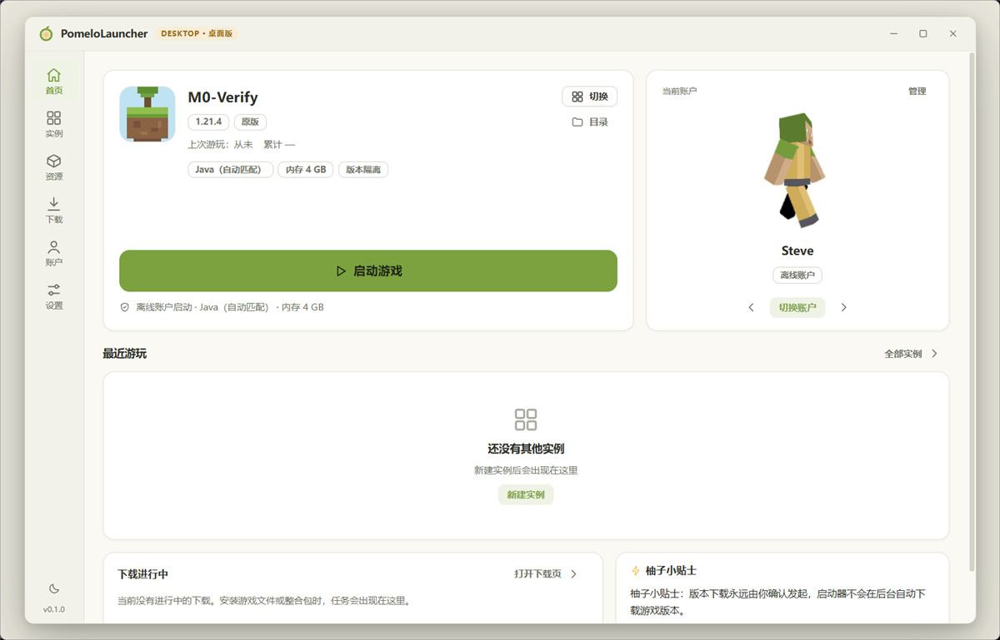
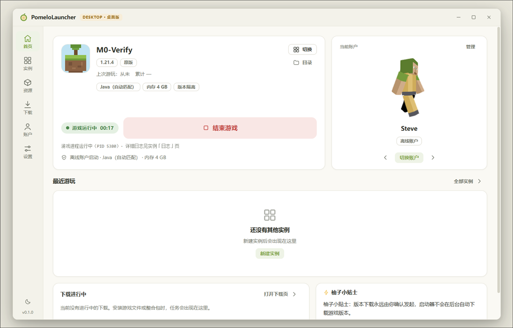

# PomeloLauncher（柚子启动器）

> 功能全面、体积轻盈、清新易用的跨平台 Minecraft 启动器 · **Apache-2.0**
> 现状：**M0 技术验证完成**——Rust 核心可真实解析版本、镜像下载、组装启动命令；桌面外壳（Tauri 2）已搭好，浏览器内仍可查看高保真 UI DEMO。

## 仓库结构

```
├── src/                      # React UI（浏览器 DEMO + 桌面版共用）
│   ├── pages/ · ui.tsx       # Pomelo Garden 设计系统与页面
│   ├── store.tsx · mock.ts   # 浏览器演示数据与状态机
│   └── desktop.ts            # Tauri 探测与 IPC 封装（桌面端自动启用）
├── src-tauri/                # Rust 工作区
│   ├── crates/pomelo-core    # 版本解析 / 规则 / Java / 账户 / 启动流水线
│   ├── crates/pomelo-downloader  # 镜像重写 / 并发下载 / SHA1 / natives
│   ├── crates/pomelo-cli     # CLI：java / versions / install / launch / info
│   └── app/                  # Tauri 2 桌面外壳（MSVC 构建）
├── docs/                     # 企划书、M0 技术验证报告
└── dist/                     # 构建产物（单文件，可直接双击）
```

## 快速开始

### 浏览器 DEMO（无需环境）
双击 [dist/index.html](dist/index.html)，或：
```bash
pnpm install && pnpm dev    # http://localhost:5173
```

### Rust 核心（真实下载/启动）
```bash
cd src-tauri
cargo run -p pomelo-cli -- java                        # 扫描本机 Java
cargo run -p pomelo-cli -- versions --limit 10 --mirror
cargo run -p pomelo-cli -- install 1.21.4 --mirror      # 用户显式安装，创建隔离实例
cargo run -p pomelo-cli -- launch <instance> --name Steve --dry-run
cargo test --workspace                                  # 12 个核心逻辑测试
```

> 实测：1.21.4 安装 4102 个文件全部成功（镜像）；CLI 已可生成完整启动命令。

### 桌面版（Windows 需 WebView2；MSVC 推荐，GNU 亦可）
```bash
cd src-tauri/app
cargo build              # 本机实测：GNU 工具链可直接构建
cargo run                # 或运行 target/debug/pomelo-launcher.exe
# MSVC 环境可用：cargo tauri dev / cargo tauri build
```

已构建产物：`src-tauri/app/target/release/pomelo-launcher.exe`。
桌面端启动后，标题栏显示 `DESKTOP · 桌面版`，设置页「桌面核心」显示 Rust 核心连接状态、数据目录与 Java 列表（实机截图见 [docs/desktop/](docs/desktop/)）；浏览器中则为演示模式。

桌面版已接通：真实实例列表/创建、用户确认安装（带进度事件）、离线账户、真实启动/结束游戏、日志查看、实时版本列表、窗口拖动/最小化/最大化/关闭。
**M1 第一批**：Fabric 加载器安装（创建实例时选择）、Modrinth 真实模组/资源包/光影安装（选择目标实例）、Java 按版本 JSON 自动匹配（26.x → Java 25）。
测试数据目录可用环境变量指定：`set POMELO_ROOT=D:\Project\PomeloLauncher\.m0-data` 后启动。

> 构建注意：app crate 已启用 tauri `custom-protocol` feature，`cargo build --release` 直接嵌入 dist；
> 若用 `cargo tauri dev` 开发前端请另起 vite（dev 模式行为以 Tauri CLI 为准）。




## DEMO 覆盖范围

| 模块 | 说明 |
| --- | --- |
| 首页 | 启动台布局：主启动面板 + 账户档案卡（skinview3d 真实 3D 皮肤、无网络时程序化兜底）；Pre-flight/进度/运行态就地切换 |
| 崩溃诊断 | 崩溃演示实例：人话原因 + 一键禁用肇事模组重试 + 脱敏求助包 |
| 实例 | 列表/筛选/新建（待安装，需显式安装）+ 8 Tab 详情 |
| 资源中心 | 双语搜索、官方 LOGO（Modrinth API）、**安装时选择目标实例** + 依赖确认 |
| 下载 | 多源任务、实时进度、暂停/继续/重试；任务标注目标实例 |
| 账户 | 微软设备码模拟、离线、皮肤站；头像优先真实渲染 |
| 设置 | 主题/主题色/壁纸/动效/字号 + **桌面核心状态** + 关于 |

外部数据源（失败自动降级，断网可用）：Modrinth API（LOGO）、mc-heads（头像/皮肤）、本地程序化皮肤。

## 文档

- [项目企划书](docs/项目企划书.md)：竞品调研、功能全集、UI 规范、架构、路线图（v1.3）
- [M0 技术验证报告](docs/M0-技术验证.md)：核心能力、CLI 用法、测试结果、桌面构建与下一步

## 许可

Apache-2.0（见 [LICENSE](LICENSE)）。第三方数据与服务条款见企划书 §9。
